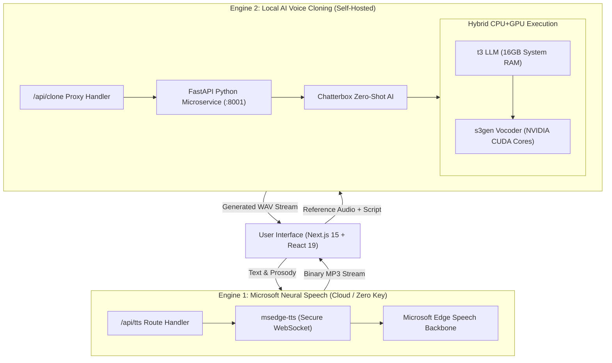

# 🎙️ S-Q TTS Studio

<div align="center">


**The Ultimate All-in-One Neural Voice Platform & Zero-Shot Voice Cloning Studio.**  
*100% Free • Zero Subscriptions • Zero API Keys • 322+ Neural Voices • Local Voice Cloning*

[✨ Live Features](#-key-features) • [🧬 Voice Cloning](#-zero-shot-voice-cloning-studio) • [🪄 Smart Tag Manager](#-smart-script-tag-manager-beta) • [🚀 Quick Start](#-getting-started) • [🏗️ Architecture](#️-architecture)

</div>

---

## 🌟 Overview

**S-Q TTS Studio** is a dual-engine speech synthesis web application. It bridges the gap between ultra-fast high-bitrate **Microsoft Neural Speech** (322 voices across 70+ languages) and state-of-the-art **Zero-Shot AI Voice Cloning** running locally on your machine with hybrid CPU+GPU acceleration.

---

## ✨ Key Features

### 1. 🎙️ Microsoft Edge Neural Synthesis
- **322+ Human-Grade Neural Voices:** Covering English, Urdu, Hindi, Arabic, Spanish, French, German, Japanese, and 70+ languages.
- **Viral Motivational & Reel Presets:**
  - `en-US-BrianNeural` (Stoic / Viral Motivational, calibrated rate & pitch).
  - `en-US-EmmaMultilingualNeural` (Gentle & Emotional Reflection).
  - `en-US-AvaNeural` (Modern Shorts & TikTok).
  - `en-GB-SoniaNeural` (Mindfulness & Meditation).
  - `ur-PK-UzmaNeural` & `ur-PK-AsadNeural` (Native Pakistani Urdu hosts).
- **Fine-Grained Prosody Controls:** Real-time SSML adjustment for Speech Rate, Pitch, and Volume.
- **Studio Audio Player:** Seek bar, playback speed scaling (1x, 1.25x, 1.5x, 2x), and direct MP3 export.

### 2. 🧬 Zero-Shot Voice Cloning Studio
- **Clone Any Voice in 5–10 Seconds:** Upload a short WAV/MP3 sample or record directly via microphone.
- **Chatterbox Engine (by Resemble AI):** Permissive MIT-licensed diffusion TTS model.
- **⚡ True Hybrid CPU + GPU Pipeline:**
  - Heavy LLM token generator (`t3`) runs across system RAM.
  - Diffusion audio vocoder (`s3gen`) executes across NVIDIA CUDA cores.
  - Zero out-of-memory crashes on tight consumer laptop GPUs (e.g., 2GB VRAM cards like MX250).
- **Local Model Caching:** Models download straight to project directory (`models_cache/`), leaving your C: system drive untouched.
- **Voice Profiles:** Save cloned voice timbres for one-click re-use.

### 3. 🪄 Smart Script Tag Manager (Beta Engine)
Effortlessly handle realistic dialogue scripts and voiceover directions containing brackets:
```text
[Soft and reflective] Sometimes, you are not sleepy.
[Short pause]
You are just carrying things you never found the words to say.
[Brief pause]
[Gentle sadness] You go to bed hoping to wake up lighter...
```
- **Dynamic 3-Tier Pattern Recognition:**
  - Emotion & direction tags (e.g. `[Thoughtful]`, `[Whispering]`, `[Gentle sadness]`) are **auto-muted** so the voice engine skips reading them aloud.
  - Pause brackets (`[Short pause]`, `[Brief pause]`, `[Long pause]`, `[Pause 2s]`) are dynamically converted to rhythmic punctuation pauses (`...`, `\n\n`).
- **Live Script Inspector:** Preview the exact spoken script before generating audio.
- **Universal Bracket Fallback:** Unknown or custom future tags are auto-sanitized without breaking synthesis.

### 4. 🎛️ Acoustic Voice Preset System
- Save and name custom combinations of **Voice + Rate + Pitch + Volume**.
- Gender filters (`All`, `♀ Female`, `♂ Male`) for rapid casting.
- LocalStorage persistence with **JSON Export & Import** capabilities.
- Presets never overwrite your script text — sound acoustics and script content stay cleanly decoupled.

---

## 🏗️ Architecture



---

## 🚀 Getting Started

### 1. Prerequisites
- [Node.js](https://nodejs.org/) v18+ (Node v20 or v22 recommended)
- [Python](https://www.python.org/) 3.11 (Required for local voice cloning)
- Git

### 2. Installation

```bash
# Clone the repository
git clone https://github.com/S-Q-Ali/S-Q-TTS.git
cd S-Q-TTS

# Install Node dependencies
npm install
```

### 3. Launch Web Application

```bash
npm run dev
```
Open **[http://localhost:3000](http://localhost:3000)** in your browser. Microsoft Neural TTS is immediately available with zero setup!

---

## 🧬 Enabling Local Voice Cloning

To run zero-shot voice cloning on your own hardware:

1. **One-Time Python Setup:**
   Navigate to the `voice-clone-server` directory and run:
   ```cmd
   cd voice-clone-server
   setup.bat
   ```
   *(This creates a dedicated Python virtual environment and installs PyTorch with CUDA acceleration).*

2. **Start the Voice Clone Microservice:**
   ```cmd
   start.bat
   ```
   The server launches at `http://localhost:8001`. On first launch, Chatterbox model weights download directly to the project's local `models_cache` folder.

3. **Clone & Synthesize:**
   Switch to the **Voice Clone Studio** tab in the web app, upload a 6-10s voice clip, and synthesize speech!

---

## 📂 Project Structure

```text
├── src/
│   ├── app/
│   │   ├── api/
│   │   │   ├── clone/route.ts      # Voice cloning proxy & health-check
│   │   │   ├── tts/route.ts        # Edge TTS binary stream handler
│   │   │   └── voices/route.ts     # 322 neural voice metadata provider
│   │   ├── layout.tsx              # Root HTML & metadata
│   │   ├── page.tsx                # Studio layout & mode switcher
│   │   └── globals.css             # Glassmorphism & custom scrollbars
│   ├── components/
│   │   ├── AudioPlayer.tsx         # Waveform audio player with download
│   │   ├── Header.tsx              # Brand header & GitHub badge
│   │   ├── HistoryList.tsx         # Local generation history
│   │   ├── TextInput.tsx           # Script editor & Tag Manager UI
│   │   ├── VoiceCloneStudio.tsx    # Live voice cloning studio component
│   │   ├── VoiceControls.tsx       # Pitch, rate, volume prosody sliders
│   │   ├── VoicePresetBar.tsx      # Acoustic presets & JSON manager
│   │   └── VoiceSelector.tsx       # Searchable multi-lingual voice grid
│   └── lib/
│       ├── presets.ts              # Demo script samples
│       ├── script-parser.ts        # 3-tier NLP tag sanitizer
│       ├── types.ts                # TypeScript interfaces
│       └── voice-presets.ts        # Built-in presets & localStorage CRUD
├── voice-clone-server/             # Python FastAPI Microservice
│   ├── server.py                   # Hybrid CPU+GPU FastAPI server
│   ├── requirements.txt            # Python dependencies
│   ├── setup.bat                   # 1-click virtual environment builder
│   └── start.bat                   # 1-click microservice launcher
├── README.md                       # Documentation
└── package.json                    # Project scripts & dependencies
```

---

## 📄 License

Distributed under the **MIT License**. Free for personal, educational, and commercial projects.
